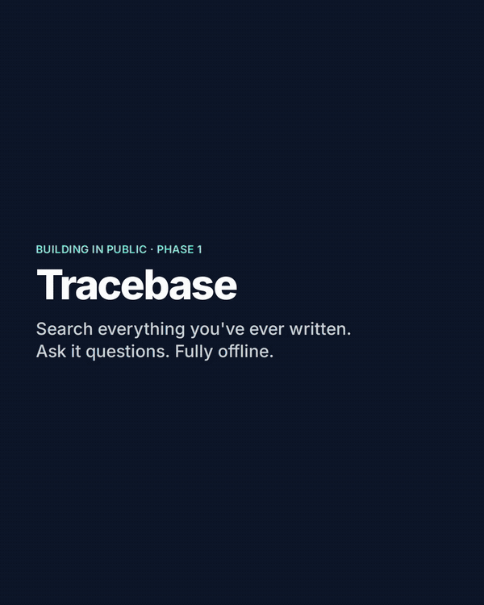
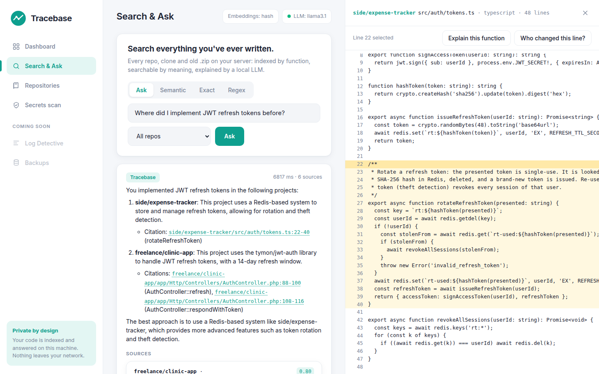
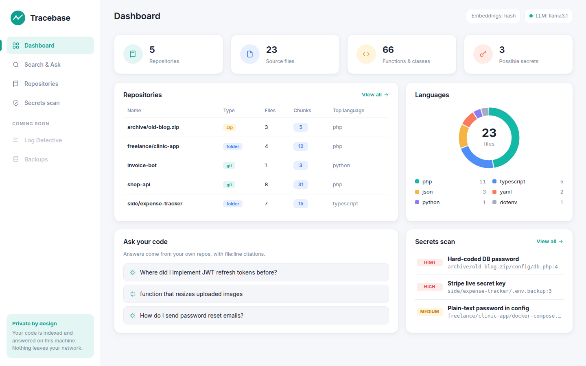

# Tracebase

**Self-hosted AI for your code, logs and backups.**
Your code, your logs and your backups in one private AI. Nothing leaves your network.



### Try it

**Live demo:** [demo.tracebase.duckdns.org](https://demo.tracebase.duckdns.org): paste the token
`tb_escsEwbpgDuxtXQ9xIxKT30IyXzO3_Mp` when asked. It holds sample projects (Laravel, Node, Python, Go, Java,
Rails) and sample production logs with two incidents. Try *"send password reset email"* in Search, or open
Log Detective.

**Run it yourself:** `git clone` this repo, then `python3 demo/seed.py && docker compose up --build` and open http://localhost:8080 (see [Run it](#run-it)).

**From your AI agent:** `pipx install tracebase-cli`, then `tracebase connect claude` (or codex, gemini,
opencode, cursor, ollama). See [MCP](#use-it-from-your-ai-agent-in-the-terminal-mcp).

Self-hosted. Runs on a NAS, a home server or any machine with Docker. Built in public, in phases:

| Phase | Part | Status |
|---|---|---|
| 1 | Core + Code Search & Q&A + copy code from your old projects | ✅ done |
| 2 | Copy upgrades: adapt copied code to the new project, Go / Java / Ruby, team mode | ✅ done |
| **3** | **Log Detective: group errors, explain them, link them to the failing code and the commit. Privacy: redaction, retention, encryption at rest, export / erase** | ✅ this release |
| 4 | Backup Guardian: git mirrors, DB dumps, verified one-click restore | next |
| 5 | The agent: one chat box across code, logs and backups | planned |
| 6 | Packaging for the NAS | planned |

**Your data:** personal data and secrets in logs (emails, IPs, card numbers, tokens, passwords) are redacted
before anything is stored; old records are deleted after a retention period; the database can be encrypted at
rest (`TRACEBASE_DB_KEY`); and the **Data & privacy** page (admins) or `tracebase data` shows, exports and erases
what is stored. The container runs as a non-root user and keeps `/data` private to it. See [PRIVACY.md](PRIVACY.md).

---

## Feature flags: Flagsmith in Log Detective

Bad releases are often a flag flip, not a deploy. Tracebase reads every flag change from
[Flagsmith](https://github.com/Flagsmith/flagsmith) (self-hosted or SaaS) and treats it as a possible cause:

1. **Flag changes on the timeline.** A signed Flagsmith webhook sends each change (turned on/off, value, % rollout,
   segment overrides, who did it) to Tracebase. They show on the error timeline and in `tracebase flags`.
2. **Flags as suspects in "why".** When an error group starts, flag changes just before it are ranked by time and
   by how they tie to the failing code: Tracebase finds where your code checks the flag (its name in quotes) and
   tells you when the failing line runs *behind that check*.
3. **Kill switch, with your approval.** `tracebase why E-6 --rollback`, the **Turn off** button, or your AI agent
   (MCP `rollback_flag`, which asks you first) turns the flag off through the Flagsmith API. Tracebase then watches
   the error: if it stops, it is marked **resolved by the rollback**; if not, an alert says the flag wasn't the cause.
4. **For AI agents.** `explain_error` names the flag, `flag_history` shows changes and where the code checks a
   flag, and `rollback_flag` is the approved kill switch.

```text
$ tracebase why E-6
Why
  Feature flag 'new_checkout' was turned on in Production by demo@tracebase.local in the minute the errors
  started, and the failing code runs only behind that flag (app/Services/CheckoutV2.php:22:
  `if ($flags->isFeatureEnabled('new_checkout')) {`). Code reads a key/property that is missing from the input…
Code  shop-api/app/Services/CheckoutV2.php:24
     22          if ($flags->isFeatureEnabled('new_checkout')) {
     23              $rates = $this->fx->latest();
  ›  24              $rate  = $rates[$cart['currency']];
Last changed by  22256cb Checkout v2: charge in the shopper's currency (behind new_checkout flag)  2026-11-02
Fix
  1. Turn off the flag 'new_checkout' in Production now (kill switch): an admin can run tracebase why E-6 --rollback, …

$ tracebase why E-6 --rollback
Turn off the flag 'new_checkout' in Production through Flagsmith? [y/N] y
✓ 'new_checkout' turned off in Production
  watching E-6 for 5 minutes: if it stops, it is marked resolved by the rollback
```

The code above shipped "dark" weeks earlier, so the commit is not blamed: the flag flip is what turned it on.

**Try it with self-hosted Flagsmith** (both run in Docker, on one private network):

```bash
python3 demo/seed.py --reset
docker compose -f docker-compose.yml -f docker-compose.flagsmith.yml up -d --build
python3 demo/flags_demo.py setup     # Flagsmith user, project, the new_checkout flag, the webhook, an API key
#   put the two printed values in .env, then:
docker compose -f docker-compose.yml -f docker-compose.flagsmith.yml up -d tracebase
python3 demo/flags_demo.py traffic   # the demo shop: checkouts every 2 s, reading new_checkout from Flagsmith
python3 demo/flags_demo.py on        # or flip it in the Flagsmith dashboard (http://localhost:8000)
tracebase errors && tracebase why E-<n> --rollback
```

**Connect your own Flagsmith.** In Flagsmith, add an environment webhook to
`https://<tracebase>/api/flags/webhook` with a secret, and set the same secret as `TRACEBASE_FLAGSMITH_WEBHOOK_SECRET`
(in team mode the webhook is refused without one). For the kill switch, create an organisation API key and set
`TRACEBASE_FLAGSMITH_URL` and `TRACEBASE_FLAGSMITH_API_KEY`. Without them, flags are still shown as suspects; only
turning them off from Tracebase is disabled. A self-hosted Flagsmith needs Tracebase's host in its
`SSRF_ALLOWED_HOSTS` when both are on a private network (the compose file does this).

The Flagsmith integration was built during the Flagsmith hackathon (November 2026) and is licensed under
**Apache-2.0** ([backend/tracebase/flags/LICENSE](backend/tracebase/flags/LICENSE)).

## Phase 3: Log Detective

Your production logs, read on your own machine. Thousands of identical errors become one group (`E-5`), and
each group comes with an explanation built from **your logs, your code and your git history**:

- **why it happened**: a rule book of common failures (connection refused, missing keys, nulls, timeouts,
  webhook signatures, deadlocks…) plus what other services logged at the same moment (a database shutting down,
  a backup job, a deploy, a restart);
- **the code that failed**: stack-trace frames (PHP, Python, Node, Java, Go, Ruby) mapped to files in your
  indexed repos, with the failing line highlighted;
- **the commit that changed it**: `git blame` on the failing line, and how long before the first error it landed;
- **how to fix it**: a concrete one-line change when there is one (`$cart['coupon']` → `$cart['coupon'] ?? null`);
- **impact**: how many times, for how long, against the service's normal error rate.

The local LLM (Ollama) rewrites the cause and the fix in plain English when it's running; counts and times
always come from the data, and it may only cite file:line locations Tracebase actually found. Without an LLM,
the rule-based explanation is used.

```bash
tracebase errors --since "last night"      # grouped errors, with spikes
tracebase why E-5                          # cause, failing code, commit, fix
tracebase resolve E-5                      # it comes back as "regressed" (and alerts) if it happens again
tracebase alerts                           # new error types, spikes, regressions
docker logs shop 2>&1 | tracebase ingest - --service shop-api
```

```
Why
  Code reads a key/property that is missing from the input. app/Services/CartService.php:57 was last changed in
  commit f971906 "Refactor applyDiscount for promo campaign (BLACKFRIDAY)" (2026-11-08 13:42), 22 minutes
  before the first error: the likely culprit.
Code  shop-api/app/Services/CartService.php:57
  ›  57          $code  = $cart['coupon'];
Fix
  1. In shop-api/app/Services/CartService.php:57 change `$code  = $cart['coupon'];` to `$code  = $cart['coupon'] ?? null;`
```

**Getting logs in.** Point `TRACEBASE_LOGS_DIR` at a folder of log files (they are tailed incrementally:
Laravel, Nginx/Apache, Python, Node, Java/Spring, MySQL, syslog, Docker and JSON logs, multi-line stack traces
included), set `TRACEBASE_DOCKER_LOGS=1` to read the containers on the host, or send lines over HTTP
(`POST /api/logs/ingest`, `tracebase ingest`, or the "Send logs" box in the UI).

**Alerts.** A new error type, an error-rate spike against the service's own baseline, and an error coming back
after being resolved each raise an alert in the UI and `tracebase alerts`. To also get them on your phone, set
`TRACEBASE_ALERT_WEBHOOK` to **your own** endpoint (a self-hosted ntfy, Slack…). It's off by default.

**From your AI agent.** The MCP server adds `find_errors` and `explain_error`: ask Claude Code, Codex or an Ollama
model "why did checkout fail last night?" and it answers from your logs and code, then can fix the line in the
current project.

**Team mode.** A member's patterns cover log services as well as repos: `--repos shop-api` sees the shop-api repo
*and* the shop-api logs, errors and alerts, and nothing else. Explanations only use code, commits and other
services that member can see. A member can only send logs for their own services.

## Phase 2: Copy upgrades and team mode

### Copied code fits the new project

Tracebase adapts what it copies, deterministically (no AI), and shows every change in the diff before writing:

- **Project name**: the old project's name in every spelling (`clinic-app`, `clinic_app`, `ClinicApp`,
  `CLINIC_APP`) becomes the new project's name.
- **Your renames**: `tracebase copy "appointments" --rename Doctor=Staff` renames
  `DoctorController` → `StaffController`, `isDoctor` → `isStaff`, `doctors` → `staffs`, `DOCTOR_ROLE` →
  `STAFF_ROLE`, and the file names with them. `Doctorate` stays untouched. Agents pass `renames` to `preview_copy`.
- **Go module and Java package**: import paths move to the new module (`github.com/me/new/internal/auth`); Java
  classes move to the new base package, folders included (`com/acme/clinic/…` → `io/acme/booking/…`).
- **Dependencies**: packages the copied code uses are added to `package.json`, `composer.json`,
  `requirements.txt`, `Gemfile` or `pom.xml` with the old project's version (Go: a `go get` line), and env vars
  it reads are documented in `.env.example`. Your `.env` is never touched.

### Go, Java and Ruby

| | Follows | Wires | Merges into existing files |
|---|---|---|---|
| **Go** (Gin, Echo, chi, Fiber) | imports of the same module, same-package helpers | routes in `main.go` / `router.go` + the import | funcs and methods, imports into the `import ( … )` block |
| **Java** (Spring) | imports, same-package classes | n/a (Spring wires by annotation) | methods into the class, imports |
| **Ruby** (Rails) | constants (autoload), `has_many :roles` → `Role`, methods, `require_relative`, migrations | `config/routes.rb`, `include` in `ApplicationController` | methods, `has_secure_password` / associations the copied code relies on |

Go won't compile an unused variable or import, so a wiring line whose companion lines weren't copied is listed as
a manual step instead of breaking the build.

### Team mode: one Tracebase for the whole team

Run one Tracebase on a server or NAS with all the team's repos, set an admin token, and give each developer
their own token with access to only the repos they work on:

```bash
TRACEBASE_ADMIN_TOKEN=$(openssl rand -hex 24) docker compose up -d       # on the server

export TRACEBASE_URL=http://nas.local:8080 TRACEBASE_TOKEN=<admin token>  # admin, anywhere
tracebase team add priya --repos "freelance/*" shop-api                  # prints Priya's token (once)
tracebase team list | repos | rotate | remove
tracebase team audit --user priya                                        # who searched, prepared and copied what

tracebase login tb_… --url http://nas.local:8080                         # Priya, on her laptop
```

- **Access is enforced on the server**, in search, ask, file reads, copies, the dashboard and the secrets scan.
  A repo outside your patterns answers "not found".
- **Tokens:** stored as SHA-256 hashes, and only accepted in the `Authorization` header, never in URLs.
- **Login file:** `tracebase login` saves to `~/.config/tracebase/config.json` (mode 600). `tracebase mcp` uses
  it too, so the token never goes into your AI agent's config.
- **Web UI:** asks for the token and shows who is signed in.
- **Audit log:** records searches for code to copy, copy previews, questions asked, and the files actually
  written (by `tracebase copy`, `tracebase apply` or an agent), with the project they went into.
- **Solo use:** without `TRACEBASE_ADMIN_TOKEN` nothing changes. There are no tokens and no audit log.

## Phase 1: Code Search & Q&A

> *"I solved this exact problem two years ago. Which repo was it in?"*

Tracebase indexes every repository on the NAS (plain folders, Git clones and old `.zip` archives) and makes it searchable by meaning. A local LLM answers questions with `repo/file:line` citations.

```
You:      Where did I implement JWT refresh tokens before?

Tracebase: 1. side/expense-tracker: src/auth/tokens.ts:22-40 (rotateRefreshToken)
             Refresh tokens hashed in Redis, rotated on every use, re-use revokes all sessions.
          2. freelance/clinic-app: app/Http/Controllers/AuthController.php:88-100 (refresh)
             tymon/jwt-auth, 14-day refresh window, old token blacklisted.
          archive/old-blog.zip only has a cookie-based "remember me" (no rotation, not recommended).
```





### Features

- **Dashboard:** repositories, languages, indexed functions and secrets at a glance.
- **Ask:** ask in plain English. The answer cites `repo/path:line`, and every citation opens the code. Citations are checked against the retrieved code, so if the model invents a file, Tracebase falls back to the grounded result list.
- **Semantic search:** "function that resizes uploaded images" finds `makeThumbnails()` even though no single line says "resize uploaded images".
- **Exact / regex search:** every usage of `sendMail(`, with exact line numbers.
- **Explain this function:** a plain-English summary of the function or class around any line.
- **Who changed this line?:** `git blame` plus the diff of that commit, in one click.
- **Secrets scan:** flags leaked API keys, private keys, hard-coded DB passwords and committed `.env` files, with values masked.
- **Incremental indexing:** a file watcher re-indexes only changed files. It respects `.gitignore` and skips `node_modules`, `vendor`, binaries and lockfiles.

### Copy code from your old projects

Search is half the job. The other half: *"I'm starting a new project. Copy the login logic from my old projects."*

Run `tracebase copy` inside the new project. Tracebase finds your own implementation, collects **everything it
needs from that old project**, and copies it in. **No AI writes the code and nothing goes to the internet.** It
copies your real, working code and shows a diff before writing anything.

```
~/code/booking-api $ tracebase copy "search my project and implement the role based access control"

● Found in your projects  (role based access control · this project: php (laravel))
  1. freelance/clinic-app app/Http/Middleware/EnsureUserHasRole.php:12-22  EnsureUserHasRole (php · laravel)
  2. freelance/clinic-app app/Models/User.php:9-46                         User (php · laravel)
  …
Copy which one? [1-8, q] (1)

● Copy from freelance/clinic-app into booking-api
  new    app/Http/Middleware/EnsureUserHasRole.php     the implementation you picked
  merge  app/Models/User.php                           defines hasRole(), called by EnsureUserHasRole (+ roles, hasRole, hasPermission)
  new    app/Models/Role.php                           Role is used by User
  new    database/migrations/…_create_roles_and_permissions_tables.php   creates the roles table for Role
  new    app/Models/Permission.php                     Permission is used by Role
  wire   app/Http/Kernel.php                           registers / uses EnsureUserHasRole
  manual routes/api.php                                applies the 'role' middleware (EnsureUserHasRole)

Review and copy 6 file(s)? [Y/n]
… a colored diff per file, then: Write app/Models/User.php?  (y)es (n)o (e)dit (a)ll (q)uit …

● Still to do by hand
  • routes/api.php: add Route::middleware('role:doctor,admin')->group(…)  (it was inside: Route::middleware('auth:api')->group(…))
```

How it decides what to copy (all deterministic):

- **Finds your implementation:** hybrid search over every repo. Code from the same framework as the current project ranks first, and filler like "search my projects and copy…" is stripped from the request.
- **Follows dependencies inside the old project:**
  - classes it uses (`Permission::class`, `use App\Models\Role`)
  - files that define methods it calls (`$user->hasRole()` → `User.php`)
  - relative imports (`../lib/redis`)
  - the migrations of models it needs
- **Brings the wiring:** for example, the line that registers the middleware alias in `Kernel.php` and the routes that use it.
- **Merges, never overwrites:** a file that already exists gets only the missing methods and the imports they need. Your existing code stays as it is, and unrelated old methods (like JWT helpers) stay behind. Wiring lines go next to the same neighbour line they had before.
- **Tells you the rest:** lines it can't place safely (e.g. routes that were inside an auth group), packages to install (`composer require tymon/jwt-auth`) and env vars to set.
- **Safe:** a diff and a y/n/edit prompt for every file. Originals are backed up to `.tracebase/backups/`. `--dry-run` only shows the plan.

Other commands:

```bash
tracebase find "jwt refresh"                  # your past implementations, with code
tracebase search "send password reset email"
tracebase show freelance/clinic-app app/Models/User.php
tracebase copy "login" --from clinic-app --pick 1 --dry-run
```

#### Use it from your AI agent in the terminal (MCP)

Connect the agent you already use, and prompt it as usual. It searches your old projects through Tracebase,
shows you what it found and **asks you before anything is written** into the current project.

```bash
tracebase connect            # lists supported agents and which ones are installed
tracebase connect claude     # Claude Code      (claude mcp add --scope user …)
tracebase connect codex      # OpenAI Codex CLI (~/.codex/config.toml)
tracebase connect gemini     # Gemini CLI       (~/.gemini/settings.json)
tracebase connect opencode   # opencode, with Ollama or cloud models
tracebase connect cursor     # Cursor / cursor-agent
tracebase connect ollama     # any Ollama model through ollmcp (pip install mcp-client-for-ollama)
tracebase connect --print    # config snippet for any other MCP client
```

Existing config files are merged (other servers are kept) and backed up first. Then, in your project:

```text
you    › search my old projects and copy the role based access control logic here
agent  › find_code → found it in freelance/clinic-app (Laravel, like this project)
agent  › preview_copy → plan bd345a: create EnsureUserHasRole.php, Role.php, Permission.php, migration,
         merge hasRole()/hasPermission() into User.php, register the 'role' alias in Kernel.php.
         Nothing written yet. Apply it?
you    › yes
agent  › apply_copy → Tracebase asks you to confirm, then writes the files (originals backed up)
```

How the approval works:

1. `preview_copy` never writes. It saves the plan in `.tracebase/pending/` (git-ignored) and returns the diff.
2. `apply_copy` asks **you** directly through MCP elicitation when the agent supports it, so the agent can't
   approve for you. For agents without it, the call is refused until the agent passes `user_confirmed=true`.
   It is told to do that only after you say yes, and it is marked as a writing tool, so your agent's permission
   prompt also applies.
3. You can always decide in a terminal instead: `tracebase pending` lists the plans, `tracebase apply <id>`
   shows each diff and asks file by file, and `tracebase discard <id>` drops one.
4. A plan is written exactly as previewed. If one of its files changed in the meantime, it is refused.

MCP tools:

| Tool | |
|---|---|
| `find_code` | your past implementations of a task (repo, path, symbol) |
| `preview_copy` | the copy plan as a diff; nothing is written |
| `apply_copy` | writes an approved plan (the only tool that writes) |
| `get_code_bundle` | a file or symbol with everything it depends on |
| `search_code` · `read_code` · `list_repos` | search and read your indexed repos |
| `find_errors` · `explain_error` | grouped production errors; cause, failing code, the commit, a fix (Log Detective) |

The prompts `copy` and `why` show up as `/mcp__tracebase__copy` and `/mcp__tracebase__why` in Claude Code.

> **Privacy:** Tracebase reads only your indexed repos and makes no internet requests. Your assistant is a different matter. If it runs a cloud model (Claude, OpenAI…), the code it reads through these tools is sent to that provider like anything else in your chat. For a fully local setup, use an Ollama model (`tracebase connect ollama` or `opencode`).

### How it works

```
 /volume1/repos ─► discover (folders · git clones · .zip)
                   │
                   ▼
            tree-sitter chunker ──► functions / classes / methods (+ docblocks)
                   │
          ┌────────┴─────────┐
          ▼                  ▼
   SQLite FTS5 (BM25)   vector index (embeddings in SQLite, cosine in numpy)
          └────────┬─────────┘
                   ▼
   hybrid ranking: 0.55·keyword + 0.45·semantic + IDF-weighted symbol-name boost
                   │
                   ▼
   local LLM (Ollama / any OpenAI-compatible endpoint) → answer with checked citations
```

- **Chunking:** tree-sitter splits code into real units (17 languages structurally, the rest by heuristics). Small classes stay whole. Large classes are split into methods, and docblocks stay attached.
- **Embeddings:** the default is a zero-dependency feature-hashing embedder (split identifiers like `sendResetEmail` → `send reset email`, stemming, code-vocabulary synonyms). It runs on any NAS CPU. Set `TRACEBASE_EMBED_PROVIDER=ollama` to use a real embedding model such as `nomic-embed-text`.
- **LLM:** one adapter (`tracebase/llm.py`), so any local or hosted model can be swapped in by config. Without an LLM, everything except the written answers and explanations still works.

### Tech stack

Python 3.12 · FastAPI · SQLite FTS5 (SQLCipher for encryption at rest) · tree-sitter · numpy · APScheduler ·
React 19 + Vite · Docker (Debian 12)

---

## Run it

**With Docker** (uses Ollama on the host if it's running):

```bash
python3 demo/seed.py              # optional: demo repos + logs in demo/volume1
docker compose up --build         # → http://localhost:8080
REPOS_DIR=~/code docker compose up --build   # index your own code (mounted read-only)
```

**Locally:**

```bash
make setup        # backend venv (uv) + npm install (+ SQLCipher where a wheel exists)
make demo         # generate demo repos
make dev          # build UI, run on http://localhost:8080
make test         # pytest
make cli          # install the `tracebase` command (copy + MCP)
```

For written answers, run `ollama pull llama3.1` (or any model).

**On a cloud server** (AWS Lightsail / EC2 or any VPS, with automatic HTTPS): one script sets up Docker, the
firewall, team mode and a repo-sync cron; `--public-demo` adds a separate, isolated demo instance at
`demo.<your domain>`. See [deploy/README.md](deploy/README.md).

### Configuration

| Variable | Default | |
|---|---|---|
| `TRACEBASE_REPOS_DIR` | `/volume1/repos` | folder to index |
| `TRACEBASE_DATA_DIR` | `./data` | index database |
| `TRACEBASE_LLM_PROVIDER` | `ollama` | `ollama`, `openai` (any compatible server) or `none` |
| `TRACEBASE_LLM_BASE_URL` | `http://localhost:11434` | |
| `TRACEBASE_LLM_MODEL` | `llama3.1` | chat model (answers, explanations) |
| `TRACEBASE_LLM_API_KEY` | *(empty)* | sent as a Bearer token to an `openai`-compatible server |
| `TRACEBASE_LLM_TIMEOUT` | `120` | seconds to wait for the LLM |
| `TRACEBASE_EMBED_PROVIDER` · `TRACEBASE_EMBED_MODEL` | `hash` · `nomic-embed-text` | `hash` or `ollama` · the Ollama embedding model |
| `TRACEBASE_WATCH_INTERVAL` | `60` | seconds between incremental re-index runs |
| `TRACEBASE_MAX_FILE_KB` | `512` | larger files are not indexed |
| `TRACEBASE_ADMIN_TOKEN` | *(empty)* | set it to turn on team mode (tokens, per-member repos, audit log) |
| `TRACEBASE_LOGS_DIR` | `/volume1/logs` | log files to watch (Log Detective) |
| `TRACEBASE_LOG_INTERVAL` | `15` | seconds between log collection runs |
| `TRACEBASE_LOG_RETENTION_DAYS` | `30` | days to keep log lines (`0` = forever) |
| `TRACEBASE_ERROR_RETENTION_DAYS` | `90` | days to keep an error group after it was last seen |
| `TRACEBASE_ALERT_RETENTION_DAYS` · `TRACEBASE_AUDIT_RETENTION_DAYS` | `90` · `365` | days to keep alerts · audit entries |
| `TRACEBASE_REDACT` · `TRACEBASE_REDACT_IPS` | `1` · `1` | redact personal data and secrets in logs before storing · IPs too |
| `TRACEBASE_REDACT_EXTRA` | *(empty)* | your own patterns, a JSON list of regexes: `["CUST-\\d{6}"]` |
| `TRACEBASE_DB_KEY` · `TRACEBASE_DB_KEY_FILE` | *(empty)* | encrypt the database (SQLCipher); keep the key safe |
| `TRACEBASE_MAX_INGEST_MB` | `20` | largest log upload |
| `TRACEBASE_CORS_ORIGINS` | *(empty)* | other sites allowed to call the API (comma-separated) |
| `TRACEBASE_DOCKER_LOGS` | `0` | `1`: also read `docker logs` of running containers |
| `TRACEBASE_ALERT_WEBHOOK` | *(empty)* | optional: push alerts to your own ntfy / Slack webhook |
| `TRACEBASE_FLAGSMITH_URL` · `TRACEBASE_FLAGSMITH_API_KEY` | *(empty)* | Flagsmith API (e.g. `http://flagsmith:8000`) and an organisation API key: turn a suspect flag off after you approve it |
| `TRACEBASE_FLAGSMITH_WEBHOOK_SECRET` | *(empty)* | secret of the Flagsmith webhook (checks `X-Flagsmith-Signature`); required in team mode |
| `TRACEBASE_FLAG_VERIFY_MINUTES` | `5` | minutes to watch an error after a flag rollback before calling it resolved |
| `TRACEBASE_SCHEDULER` | `1` | `0`: no background re-index, log collection or retention (tests, one-off runs) |
| `TRACEBASE_FRONTEND_DIST` | `../frontend/dist` | built UI to serve (`/app/ui` in the image) |
| `TRACEBASE_RUN_AS_ROOT` | `0` | Docker only: `1` keeps the container running as root instead of the `tracebase` user |

### API

| Endpoint | |
|---|---|
| `GET /api/health` · `GET /api/stats` | version, LLM, scheduler, team mode · dashboard counts |
| `GET /api/code/search?q=&repo=&language=&limit=` | hybrid search |
| `GET /api/code/grep?pattern=&regex=` | exact / regex search |
| `POST /api/code/ask` `{question, repo?}` | Q&A with citations |
| `POST /api/code/explain` `{repo, path, line?}` | explain a function |
| `GET /api/code/history?repo=&path=&line=` | git log / blame |
| `GET /api/code/file`, `/api/code/repos`, `/api/code/tree`, `/api/code/secrets` | |
| `POST /api/code/reindex` · `GET /api/code/index-status` | re-index now · progress |
| `POST /api/reuse/examples` `{task, project?}` | your best past implementations of a task |
| `POST /api/reuse/bundle` `{repo, paths, project?, symbol?, renames?}` | a file + everything it needs, adapted to the project |
| `GET /api/logs/groups?since=&service=&status=&q=` | error groups (`since`: "last night", "2h", "7d"…) |
| `GET /api/logs/groups/E-5` · `POST …/explain` · `POST …/status` `{status}` | one group · its explanation · resolve / known / ignore |
| `GET /api/logs/groups/E-5/flags` · `POST …/rollback` `{change_id, confirm}` | flag suspects and rollbacks · turn the flag off (admin) |
| `POST /api/flags/webhook` · `GET /api/flags/changes?feature=&since=` · `GET /api/flags/where?feature=` | Flagsmith webhook (signed) · flag history · where the code checks a flag |
| `POST /api/logs/ingest?service=` | send logs: raw text, `{"lines": […]}` or `{"events": […]}` |
| `POST /api/logs/collect` | read log files and Docker logs now (admin) |
| `GET /api/logs/services`, `/api/logs/timeline`, `/api/logs/events`, `/api/logs/stats` | |
| `GET /api/alerts?unread=` · `POST /api/alerts/read` | alerts |
| `GET /api/team/me` | who you are and which repos you see |
| `GET/POST /api/team/users`, `PUT …/{name}/repos`, `POST …/{name}/rotate`, `DELETE …/{name}` | members (admin) |
| `GET /api/team/audit?user=&action=` · `POST /api/team/events` | audit log (admin) · report a copy |
| `GET /api/data/summary` · `GET /api/data/export?service=&match=` | what is stored · export as NDJSON (admin) |
| `POST /api/data/purge` · `DELETE /api/data/services/{s}` · `DELETE /api/data/repos/{r}` · `POST /api/data/prune` · `POST /api/data/wipe` | erase data (admin, see [PRIVACY.md](PRIVACY.md)) |

```
GET /api/code/search?q=send+password+reset+email&limit=2
{ "results": [
    { "repo": "side/expense-tracker", "path": "src/mail/reset.ts", "lines": [5, 13], "symbol": "sendResetEmail", "score": 0.95 },
    { "repo": "freelance/clinic-app", "path": "app/Notifications/ResetPassword.php", "lines": [9, 38], "symbol": "ResetPassword", "score": 0.74 } ],
  "took_ms": 3 }
```

## Project layout

```
backend/tracebase/
  main.py            FastAPI app (+ serves the built UI)
  config.py db.py    settings, SQLite schema (FTS5)
  llm.py             LLM adapter (Ollama / OpenAI-compatible)
  embeddings.py      embedder + in-memory vector index
  scheduler.py       re-index, log collection, retention
  redact.py          personal data + secrets removed from logs before storage
  privacy.py         retention, forget / purge / export / wipe, redaction of older data
  team.py            team mode: tokens, per-member repo + log-service access, audit log
  logs/              parser (many formats + stack traces), grouper (fingerprints, spikes), collector
                     (files, Docker, HTTP), explain.py (rules + code + git blame + other services + local LLM)
  alerts.py          alerts (UI, CLI, optional webhook) · timeutil.py: "last night", "2h", …
  code/              sources (folder/git/zip), chunker, indexer, search, qa, secrets, git
  reuse/             stack detection, finding past implementations, dependency bundles (PHP, JS/TS, Python,
                     Go, Java, Ruby), adapt.py (renames, Go module, Java package). No LLM
cli/tracebase_cli/   `tracebase` command + MCP server: copy, merge, wiring, deps/.env, pending plans,
                     `connect`, `login` / `team`, `errors` / `why` / `ingest`, `data` (talks to the server over HTTP)
frontend/src/        React UI: Dashboard, Search & Ask, Repositories, Log Detective, Secrets scan, Data & privacy
deploy/              cloud server: docker-compose.prod.yml (Tracebase + Caddy HTTPS + optional public demo),
                     setup.sh, repo-sync cron
docker-entrypoint.sh drops root, keeps /data private (mode 700)
PRIVACY.md           what is stored, redaction, retention, encryption, export and erase
demo/seed.py         demo repos (Laravel, Node, Python, Go/Gin, Java/Spring, Rails, a git repo with history,
                     an old .zip) + workspace/booking-{api,go,java,rails}, fresh projects to copy into
                     + logs/: two nights of production logs with two incidents (`seed.py --logs` adds only those)
```

## License

[Functional Source License 1.1, Apache 2.0 future license (FSL-1.1-ALv2)](LICENSE.md). You may use, run, self-host
and modify Tracebase for any purpose except offering a product or service that competes with it. Each release
becomes Apache 2.0 (fully open source) two years after it is published.

The feature flag integration (`backend/tracebase/flags/`, its tests and `demo/flags_demo.py`) is Apache-2.0 now.
